# Home Control

A Home Assistant app for the heating, lighting, cameras, Wi-Fi and energy of the whole house, in one panel.

- **Heating**: room-by-room schedules for Hive and Zigbee radiator valves, with the boiler fired whenever a room needs heat. Boost, snooze, open-window detection, warming early to be ready on time, phone alerts, gas cost, when each room and the boiler should next heat (checked against what happens), easing off before a drop, firing rooms together, alerts when a room loses heat faster than usual, and Insights into how each room warms, holds its heat and copes with the weather.
- **Lighting**: lights and smart sockets in groups, with on/off, dimming and warmth schedules (including sunrise and sunset times and slow fades), scenes, movement and light-level sensors, seasons, and a lived-in Away pattern.
- **Cameras**: any camera Home Assistant knows about, with movement alerts (with a picture) and recording on schedules, offline alerts, and each camera's own settings in one place.
- **Wi-Fi** (UniFi): access points, networks and who's connected; switch networks and access points off and on, the access points' lights off at night, a network on only at set times, and a QR code for guests to join.
- **Energy** (Octopus, or Home Assistant's Energy dashboard): the electricity price now and for today and tomorrow, today's cost, the car's charging on Intelligent Octopus (bump charge, charge target, ready-by), plans that switch a socket on at the cheapest time, phone alerts when it's cheap, and each day's cost and what used the most.
- **One Away** for everything, switched by hand or by people's phones.
- **Use the parts you want**: heating, lighting, cameras, Wi-Fi and energy can each be turned on or off in Settings.
- **Dashboard card and sensors**: the Home Control card shows every room and light group at a glance, and switches and dims lights. The app installs and updates the card itself.

## Screenshots

**Heating**: every room's temperature, what it's aiming for and why, today's graph, and the boiler.

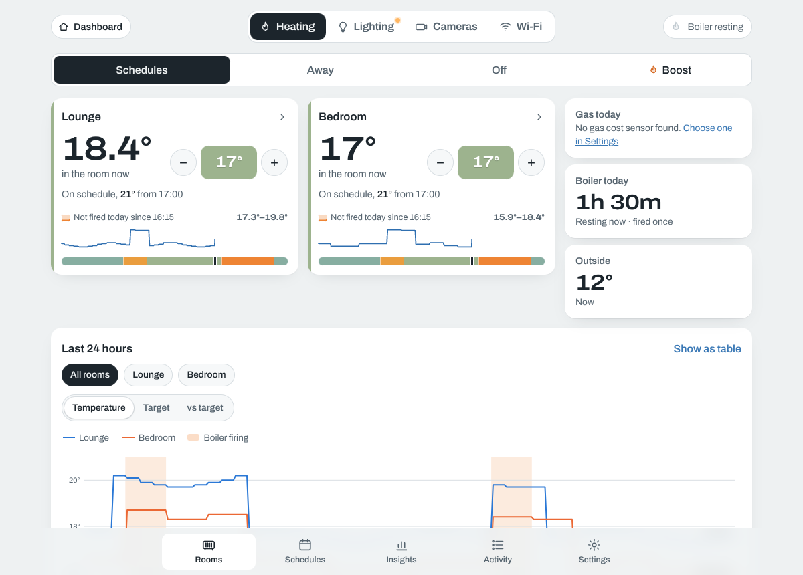

**Lighting**: each group in the colour of its light, with power, dimming and its schedule for the day.

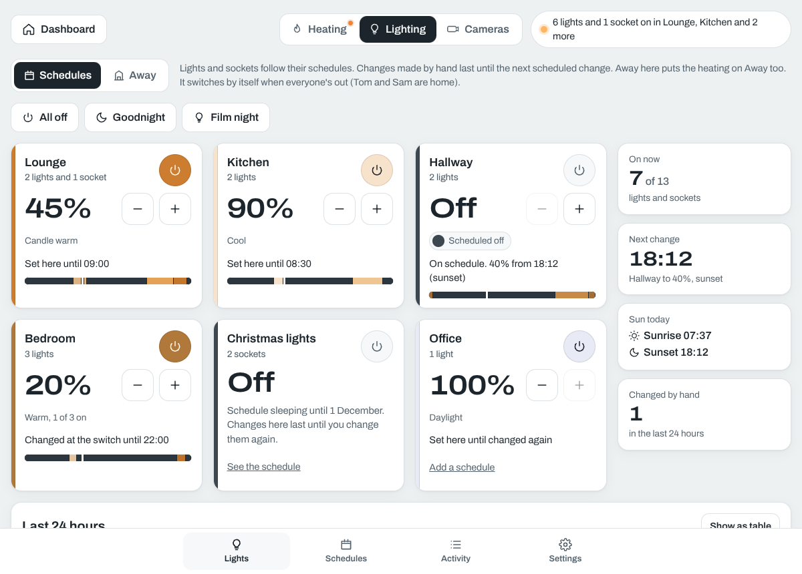

**Schedules**: a week at a glance, coloured by temperature for rooms and by light for groups.

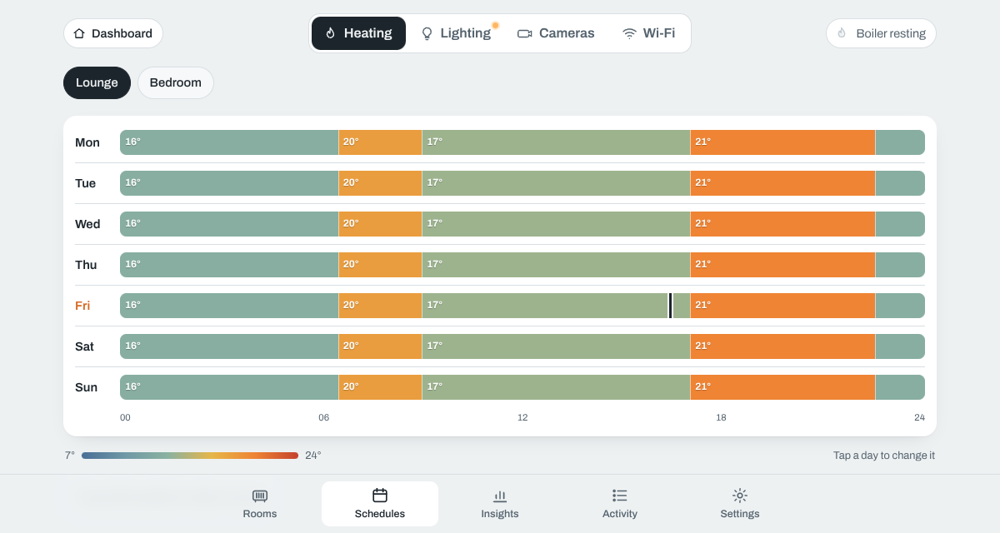

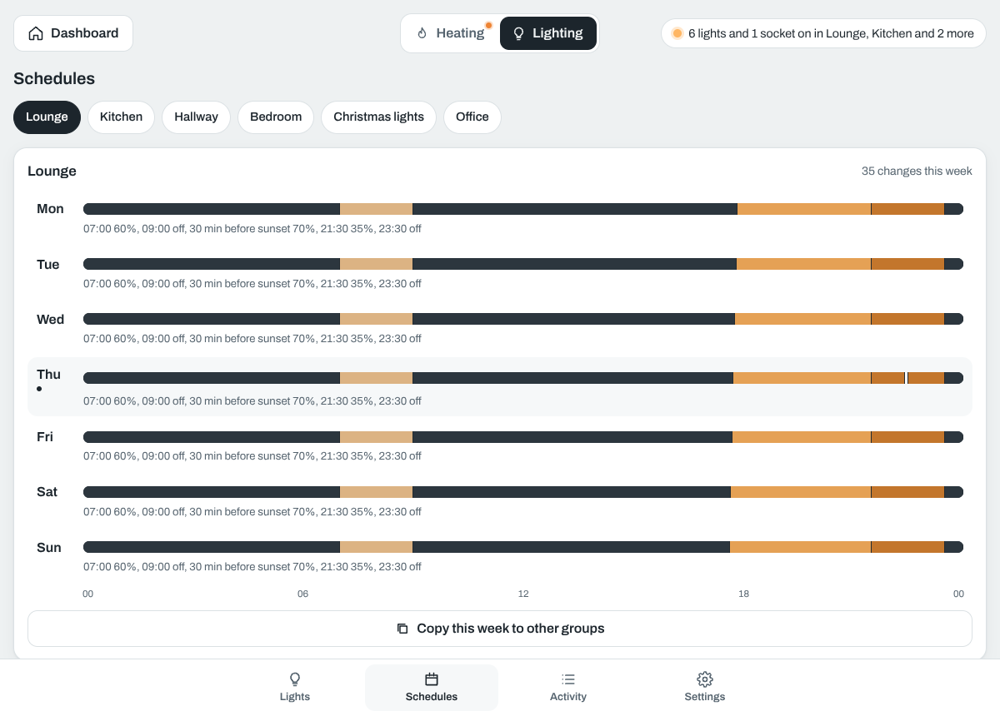

**On a phone**, light or dark:

  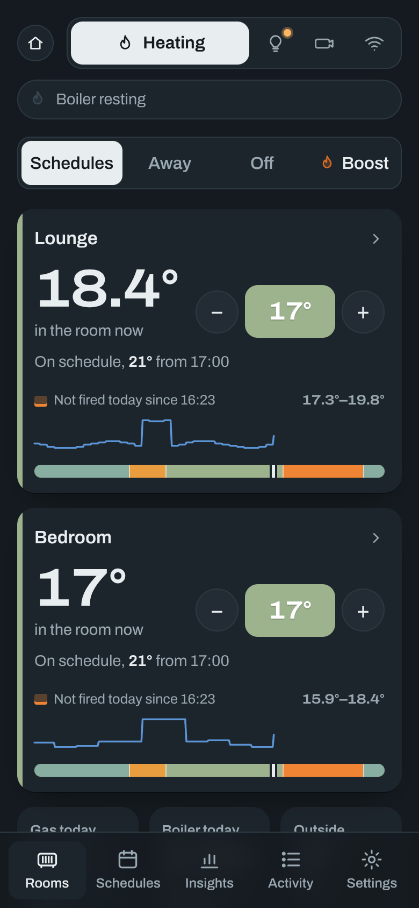
  &nbsp;
  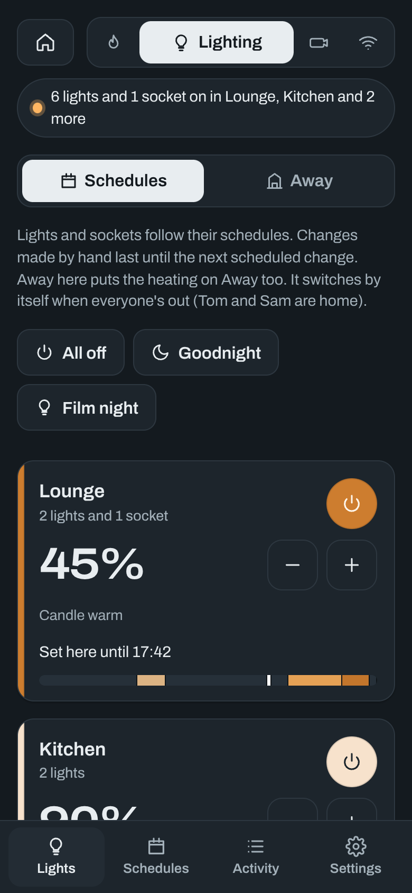
  &nbsp;
  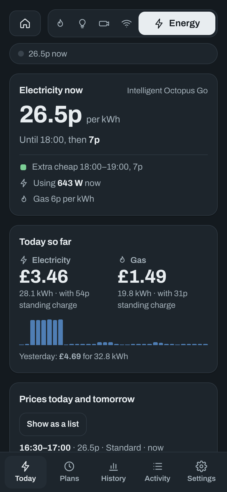

**Cameras**: every camera at a glance, what it last saw, alerts and recording on each camera's own schedule, and its own settings a tap away.

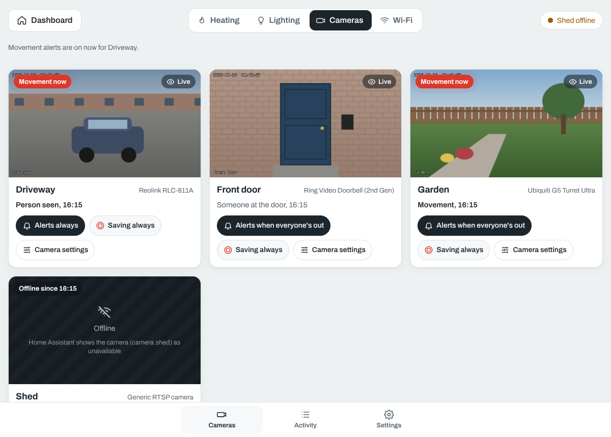

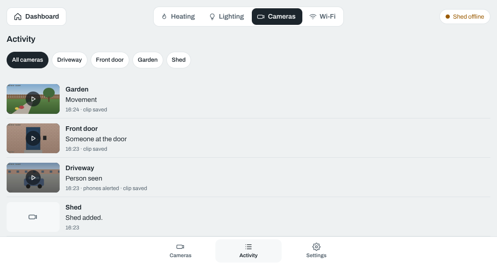

**Wi-Fi**: each access point with who's on it and its status light, the networks with a switch each, and every device on the network.

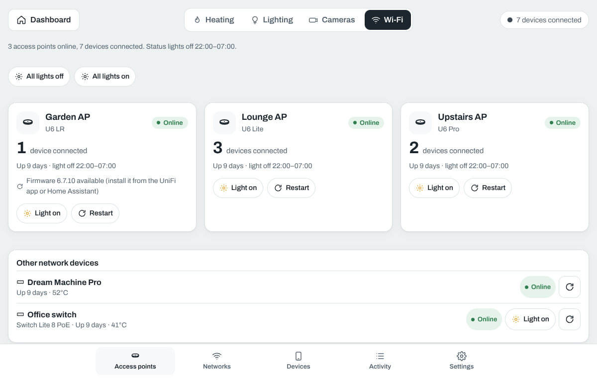

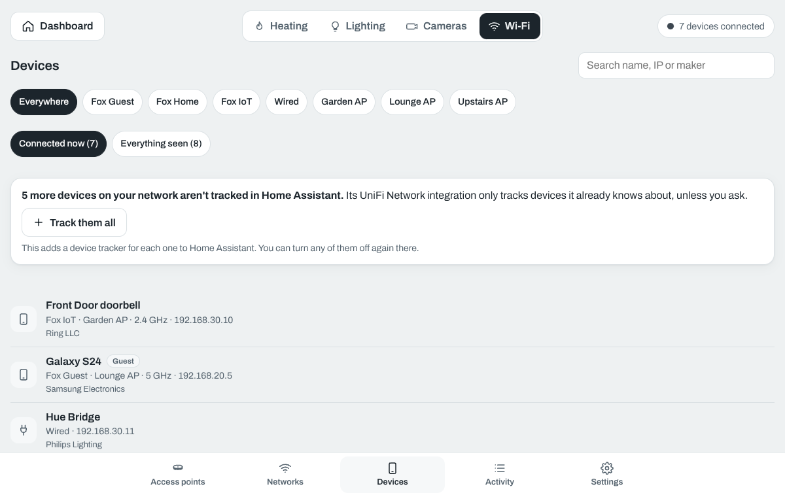

**Energy**: the electricity price now and every half hour today and tomorrow, today's cost, the car's charging on Intelligent Octopus, and plans that run the dishwasher or washing machine at the cheapest time.

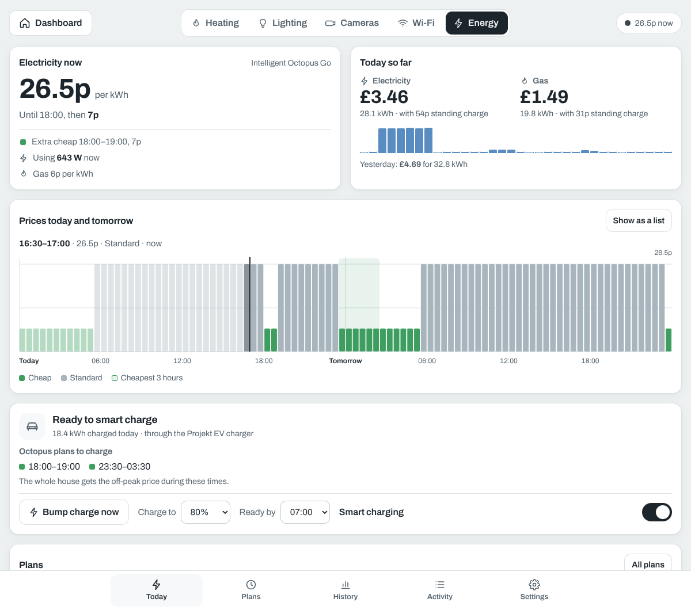

**The dashboard card**: the heating at a glance, and every light group with power and dimming. Groups can be hidden from the card, or shown only in their season.

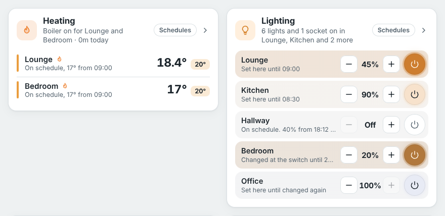

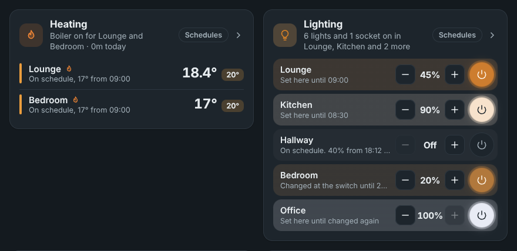

## Install

Or in Home Assistant: Settings → Apps → App store → ⋮ → Repositories, and add `https://github.com/tommiethefox80/ha-home-control`. Then install **Home Control**, start it and open it.

New versions then appear in Home Assistant as "Update available": press Update.

The documentation is on the app's Documentation tab in Home Assistant, and in [home_control/DOCS.md](home_control/DOCS.md). What changed in each version is in [home_control/CHANGELOG.md](home_control/CHANGELOG.md).

## For development

- `home_control/server`: the Node.js server (no dependencies) that runs the heating, lighting, cameras, Wi-Fi and energy, talks to Home Assistant and serves the web app.
- `home_control/web`: the web app (React, built with Vite). The built copy in `web/dist` is committed, so Home Assistant only has to build a small image: rebuild it with `cd home_control/web && npm ci && npm run build`.
- `home_control/dashboard`: the dashboard card.
- `home_control/dev`: a stand-in Home Assistant and end-to-end checks (`sh dev/run.sh`, then the `*-test.js` scripts).
